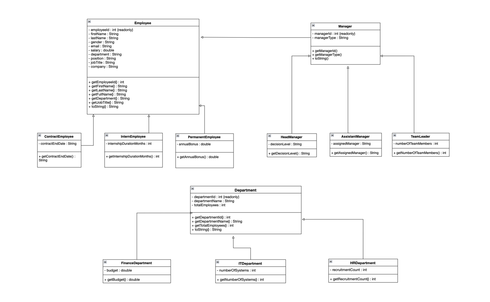
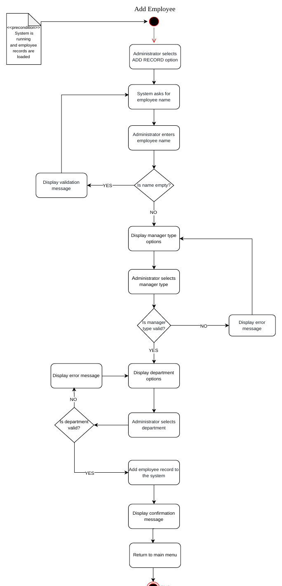

# Bank Organisation System

Java console app I built for my HDip in Computing at CCT College Dublin (May 2026). It manages a bank's employees: it reads them from a file, sorts and searches them by name, adds new ones with validation and builds the staff hierarchy as a binary tree.

Before writing any code, I planned the system with use cases, UML diagrams, requirements and user stories. The full design report is in [`docs/SDF-design-report.pdf`](docs/SDF-design-report.pdf).

## What it does

- Reads 46 employee records from a CSV file
- Sorts them alphabetically (recursive bubble sort) and searches by name (recursive binary search)
- Adds new employees, validating name, email, manager type and department
- Builds a binary tree with level-order insertion and shows its height and node count

## Design





Use case and component diagrams are in [`docs/diagrams`](docs/diagrams).

## Running it

Needs JDK 17+. Open the folder in NetBeans and run it, or:

```
javac -d out src/main/java/CA_2/*.java
java -cp out CA_2.CA_2
```

## Notes

I used bubble sort because the dataset is small and it kept the code easy to follow. With more data I'd switch to merge sort.
