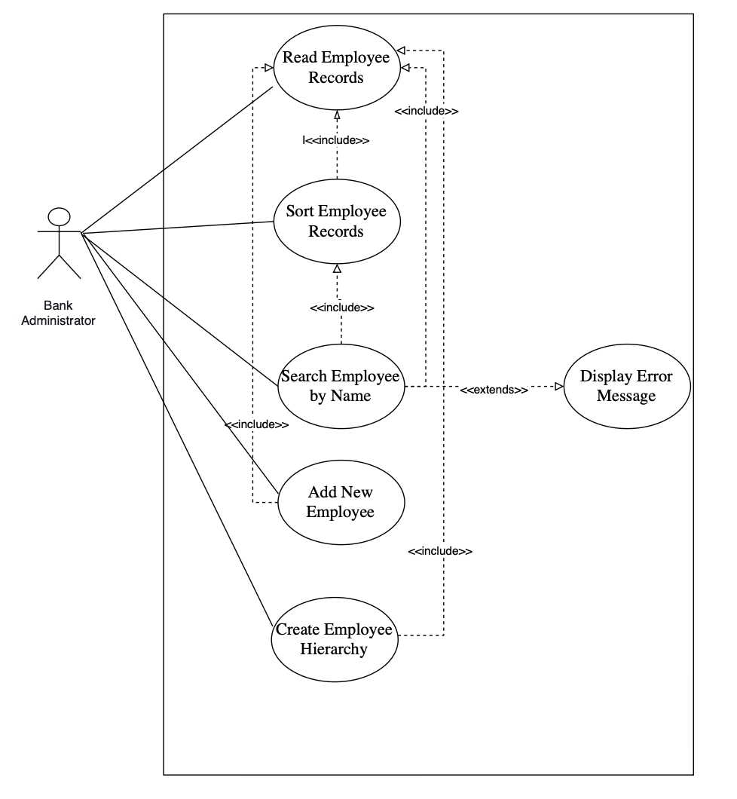
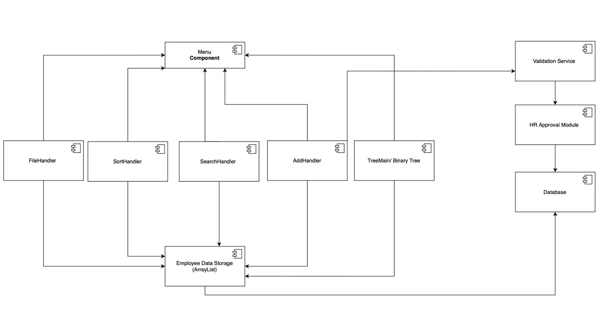

# Bank Organisation System

A Java command-line application that models the staff structure of a bank. It loads employee records from a file, sorts and searches them with recursive algorithms, validates new records, and builds the employee hierarchy as a binary tree.

The system was **designed before it was coded**: use cases, UML models, requirements, user stories and test plans were produced first, then implemented in Java.

> Academic project for the *Algorithms & Constructs* and *Software Development Fundamentals* modules of the Higher Diploma in Computing at CCT College Dublin (May 2026).

## Features

| Menu option | What it does |
|---|---|
| **Read file** | Loads 46 employee records from a CSV file into memory, with error handling for a missing file |
| **Sort** | Sorts employees alphabetically with a **recursive bubble sort** and shows the first 20 |
| **Search** | Finds an employee by full name with a **recursive binary search** and shows their department and role |
| **Add record** | Adds a new employee with input validation (name, email, manager type and department must be valid) |
| **Create binary tree** | Builds the hierarchy with **level-order (breadth-first) insertion** and prints the level-order traversal, tree height and node count |

The menu is driven by a Java **enum** (`MenuOption`), and invalid menu input is handled without crashing.

## Tech and concepts

- **Java 17+**, Maven, NetBeans
- **Object-oriented design:** three parent classes (`Employee`, `Manager`, `Department`), each with three subclasses
- **Algorithms:** recursion, recursive sorting, recursive binary search
- **Data structures:** `ArrayList`, binary tree with queue-based level-order insertion
- **Design:** UML (use case, class, activity and component diagrams), functional and non-functional requirements, user stories with acceptance criteria
- **Version control:** Git and GitHub

## Design

### Class diagram
Inheritance hierarchy for employees, managers and departments.


### Use case diagram
Five use cases for the bank administrator, with `<<include>>` dependencies.



### Activity diagram: Add Employee
Normal flow plus the validation paths for empty names and invalid manager types or departments.


### Component diagram
Current components, plus possible future ones (validation service, HR approval module and a database).



## How to run

Requirements: **JDK 17 or later**.

**With NetBeans:** open the project folder (it contains `pom.xml`) and click **Run**.

**From the terminal:**

```bash
javac -d out src/main/java/CA_2/*.java
java -cp out CA_2.CA_2
```

Run the program from the project root, so it can find `Applicants_Form - Sample data file for read.txt`. Choose option **1** first to load the employee records.

## Sample output

```text
===== BANK SYSTEM =====
1. READ FILE
2. SORT
3. SEARCH
4. ADD RECORD
5. CREATE BINARY TREE
6. EXIT
Select an option: 2
SORT selected.

===== FIRST 20 SORTED EMPLOYEES =====
Alex Turner - IT Development - Backend Developer
Amelia King - Marketing - Marketing Specialist
Benjamin Hill - Customer Service - Head Manager
...

Select an option: 3
Enter employee full name: Alex Turner
Employee found:
Alex Turner - IT Development - Backend Developer

Select an option: 5
Binary tree created successfully.
Total nodes in tree:20
Tree height: 5

===== LEVEL ORDER TRAVERSAL =====
Name: Alex Turner | Manager Type: middle | Department: IT Development
Name: Amelia King | Manager Type: middle | Department: Marketing
...
```

## Testing

Manual test plans were written and executed for the four main features. All steps passed, including the error paths:

| Test | Includes |
|---|---|
| Read employee records | Valid file, missing file |
| Sort employee records | Sorted output, sorting before any file is loaded |
| Add employee validation | Valid record, name with numbers, email without `@`, invalid manager type, invalid department |
| Search employee records | Existing employee, employee that does not exist |

## Project structure

```text
src/main/java/CA_2/
├── CA_2.java              # Entry point and enum-driven menu
├── MenuOption.java        # Menu options enum
├── FileHandler.java       # Reads the CSV file into Employee objects
├── SortHandler.java       # Recursive bubble sort
├── SearchHandler.java     # Recursive binary search
├── AddHandler.java        # New employee input and validation
├── TreeBinary.java        # Binary tree node
├── TreeMain.java          # Level-order insertion, traversal, height and count
├── Employee.java          # + PermanentEmployee, ContractEmployee, InternEmployee
├── Manager.java           # + HeadManager, AssistantManager, TeamLeader
└── Department.java        # + ITDepartment, HRDepartment, FinanceDepartment
docs/
├── diagrams/              # UML diagrams
└── Algorithms-report.docx # Algorithm choices and evidence of functionality
```

## What I would improve next

- Replace the bubble sort with **merge sort**, which scales better for large datasets (bubble sort was chosen here for readability with a small dataset)
- Add **JUnit** tests based on the manual test plans
- Persist new employees to a **database** instead of memory only, as shown in the component diagram
